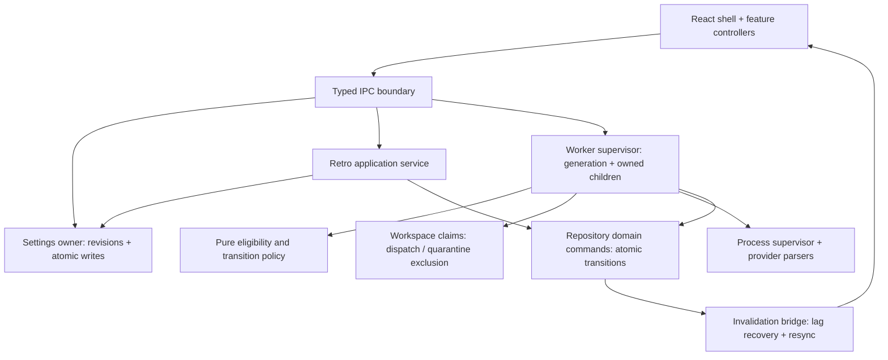

# Architecture audit — 2026-10-12

**Keep the existing crate architecture. Prioritize ownership, cancellation, and atomic state changes before further feature work.**

- **Revision:** `f612d67da1645ddfda00da6ee12eb9ac787a2724` · version 0.1.28.
- **Point-in-time report:** findings describe that revision. See [the refactor acceptance record](REFACTOR-WAVES.md) for subsequent changes and validation.
- **Scope:** core/domain, worker, storage, tracker, agent adapters, Tauri commands/settings/retros, React, IPC, tests, CI, architecture documentation.
- **Method:** four parallel code reviews, baseline validation, targeted failure probes, and cross-checking findings against current implementation.
- **Evidence labels:** **Reproduced** = executed probe; **Inspected** = concrete code path/interleaving; **Design** = recommended structural improvement.
- **Priority:** P1 = address before expanding unattended execution; P2 = next reliability/architecture work; P3 = subsequent measured improvement.
- This is a source audit with focused runtime checks, not an exhaustive security assessment or native-provider certification. No production code was changed during the audit itself.

## Basis

The audit applies pstack's [architecture workflow](https://github.com/cursor/plugins/blob/main/pstack/skills/architect/SKILL.md) and [design red flags](https://github.com/cursor/plugins/blob/main/pstack/skills/architect/references/design-red-flags.md): judge boundaries by the invariants they hide, ownership they establish, and complexity callers must understand.

| Principle | Audit question |
| --- | --- |
| [Model the domain](https://github.com/cursor/plugins/blob/main/pstack/skills/principle-model-the-domain/SKILL.md) | Can the representation express invalid lifecycle combinations? |
| [Boundary discipline](https://github.com/cursor/plugins/blob/main/pstack/skills/principle-boundary-discipline/SKILL.md) | Are external data and storage details normalized once? Is policy independent of framework wiring? |
| [Type system discipline](https://github.com/cursor/plugins/blob/main/pstack/skills/principle-type-system-discipline/SKILL.md) | Do types carry semantic states, identities, and validated values across layers? |
| [Idempotency](https://github.com/cursor/plugins/blob/main/pstack/skills/principle-make-operations-idempotent/SKILL.md) | Does retry/restart converge after every partial operation? |
| [Shared-state ownership](https://github.com/cursor/plugins/blob/main/pstack/skills/principle-separate-before-serializing-shared-state/SKILL.md) | Can actors own separate state? Where sharing is necessary, is ownership enforced? |
| [Reader load](https://github.com/cursor/plugins/blob/main/pstack/skills/principle-minimize-reader-load/SKILL.md) | Can a reader locate state and every writer without tracing unrelated features? |
| [Behavioral verification](https://github.com/cursor/plugins/blob/main/pstack/skills/principle-test-behavior-not-implementation/SKILL.md) | Do tests exercise the failure and observable result? |
| [Structural enforcement](https://github.com/cursor/plugins/blob/main/pstack/skills/principle-encode-lessons-in-structure/SKILL.md) | Are documented invariants enforced by ownership, types, transactions, or executable checks? |

Additional lenses: structured concurrency, transaction consistency, bounded resource use, failure isolation, least privilege, accessible interaction, and React performance. Pstack guidance was used as an audit rubric; its multi-model implementation workflow was not run.

## Architecture assessment

| Area | Assessment |
| --- | --- |
| Crate dependency direction | Good: pure core, separate adapters/storage, worker orchestration, desktop composition; policy checked in CI. |
| Ownership within operations | Main weakness: detached tasks, process cleanup gaps, settings writers, cleanup/dispatch races. |
| Durable invariants | Good foundations, incomplete operation boundaries: terminal transitions guarded, but retry/suppression/accounting often separate. |
| External and UI contracts | Generated and checked, but storage strings and incomplete external collections still leak into domain/UI logic. |
| Frontend async behavior | Strong refresh and listener machinery; feature ownership, mutation bookkeeping, and bootstrap isolation need work. |
| Verification | Broad passing suite; targeted adversarial probes expose gaps in lifecycle and interaction coverage. |

### Preserve

- Pure routing, prompt rendering, project-reference parsing, and backoff.
- Tracker/agent traits and deterministic provider fixtures.
- SQLite constraints, transactional migrations, guarded terminal updates, and retro reservation checks.
- Pending runs counting against concurrency; per-run configuration snapshots.
- Durable workspace quarantine and symlink-aware cleanup.
- Generated bindings, IPC/projection checks, crate-boundary enforcement.
- Dashboard generation/dirty-version reconciliation, late-listener cleanup, lazy views, virtualized events, and bundle budgets.

## P1 — ownership and durable correctness

### 1. Make worker shutdown own all child runs

**Inspected · domain modeling / structured concurrency**

- `start()` accepts `Stopping`; an old task unconditionally clears the new task's status, token, handle, and configuration. See [start and cleanup](https://github.com/anantjain-xyz/symphony-rust/blob/f612d67da1645ddfda00da6ee12eb9ac787a2724/crates/symphony-worker/src/manager.rs#L195).
- Run tasks are detached; worker shutdown joins only polling and terminal cleanup. A reported `Stopped` state does not establish that all agents have exited. See [worker join](https://github.com/anantjain-xyz/symphony-rust/blob/f612d67da1645ddfda00da6ee12eb9ac787a2724/crates/symphony-worker/src/manager.rs#L512) and [dispatch tasks](https://github.com/anantjain-xyz/symphony-rust/blob/f612d67da1645ddfda00da6ee12eb9ac787a2724/crates/symphony-worker/src/manager.rs#L1146).
- **Change:** one generation-scoped supervisor owns run tasks and process completion. Reject/serialize start while stopping; fence cleanup by generation. Represent running/stopping resources as state variants.
- **Acceptance:** immediate stop/start and slow-cancelling-child tests prove one live generation and no workspace reuse before its previous process exits.

### 2. Give every provider one complete subprocess lifecycle

**Reproduced · root-cause correction / boundary discipline**

| Fault | Evidence |
| --- | --- |
| Parse errors leave descendants running | Fake Codex returned a JSON error; its child subsequently wrote a marker. [Error exit](https://github.com/anantjain-xyz/symphony-rust/blob/f612d67da1645ddfda00da6ee12eb9ac787a2724/crates/symphony-agents/src/lib.rs#L217) bypasses group cleanup; [kill-on-drop](https://github.com/anantjain-xyz/symphony-rust/blob/f612d67da1645ddfda00da6ee12eb9ac787a2724/crates/symphony-agents/src/lib.rs#L1810) covers the direct child. |
| Stdin can bypass cancellation/deadlines | Every adapter writes the prompt before entering timeout selection; [Codex example](https://github.com/anantjain-xyz/symphony-rust/blob/f612d67da1645ddfda00da6ee12eb9ac787a2724/crates/symphony-agents/src/lib.rs#L194). A 2 MiB unread prompt exceeded a 1,200 ms outer deadline despite a 100 ms turn limit and cancellation at 50 ms. |
| Cursor EOF can bypass cancellation/deadlines | [Exit wait](https://github.com/anantjain-xyz/symphony-rust/blob/f612d67da1645ddfda00da6ee12eb9ac787a2724/crates/symphony-agents/src/lib.rs#L1105) happens outside the selected lifecycle. EOF followed by a sleeping process also exceeded 1,200 ms. |
| Undrained stderr stalls providers | [All providers pipe stderr](https://github.com/anantjain-xyz/symphony-rust/blob/f612d67da1645ddfda00da6ee12eb9ac787a2724/crates/symphony-agents/src/lib.rs#L1813); only [OpenCode drains it](https://github.com/anantjain-xyz/symphony-rust/blob/f612d67da1645ddfda00da6ee12eb9ac787a2724/crates/symphony-agents/src/lib.rs#L1478). A noisy Codex fixture timed out; the same output pattern completed through OpenCode. |

- **Change:** a shared supervisor owns stdin pumping, concurrent stdout/stderr draining, deadline, cancellation, process-group termination, and reaping. Provider modules own protocol parsing only. Ensure task abandonment still triggers supervised cleanup.
- **Acceptance:** run all four cases against every applicable provider, plus cancellation while waiting on event delivery. Bound stderr retention and maximum protocol-record size.
- These include existing documented debts in the adapter contract; documentation is not enforcement.

### 3. Make settings a single revisioned resource

**Inspected · shared-state ownership / idempotency**

- [Save](https://github.com/anantjain-xyz/symphony-rust/blob/f612d67da1645ddfda00da6ee12eb9ac787a2724/src-tauri/src/lib.rs#L168), [retro application](https://github.com/anantjain-xyz/symphony-rust/blob/f612d67da1645ddfda00da6ee12eb9ac787a2724/src-tauri/src/lib.rs#L997), and [migration during reads](https://github.com/anantjain-xyz/symphony-rust/blob/f612d67da1645ddfda00da6ee12eb9ac787a2724/src-tauri/src/lib.rs#L1513) all write the settings file directly.
- Retro application reads settings, performs repository network work, then writes the old full object with an updated prompt. A save during that interval can be silently overwritten. Direct truncating writes can also leave invalid JSON after interruption.
- **Change:** one settings owner with revision checks and atomic file replacement. Apply a prompt-only update against an expected revision; preserve concurrent unrelated fields or return a conflict. Run migrations through the same owner.
- Coordinate credential updates and worker reconfiguration with explicit outcomes; saving currently changes keychain before the file write and can leave partial state on failure.
- **Acceptance:** interleave Save/retro/migration; inject write failures; verify old-or-new valid JSON, conflict reporting, and no unrelated setting loss.

### 4. Commit run outcome and scheduling intent together

**Inspected · atomicity / idempotency**

- [Failure completion](https://github.com/anantjain-xyz/symphony-rust/blob/f612d67da1645ddfda00da6ee12eb9ac787a2724/crates/symphony-worker/src/manager.rs#L1790) commits before retry scheduling.
- [Cancellation](https://github.com/anantjain-xyz/symphony-rust/blob/f612d67da1645ddfda00da6ee12eb9ac787a2724/crates/symphony-worker/src/manager.rs#L1696) commits before dispatch suppression and retry removal. A crash can make a canceled issue eligible again.
- [Stranded-run recovery](https://github.com/anantjain-xyz/symphony-rust/blob/f612d67da1645ddfda00da6ee12eb9ac787a2724/crates/symphony-worker/src/manager.rs#L1229) skips already-terminal rows, so it does not repair these partial transitions.
- **Change:** repository commands such as `fail_and_schedule_retry`, `cancel_and_suppress`, and `request_retry` own transactions. Emit invalidations after commit.
- **Acceptance:** inject failure between every constituent write, reopen the database, and assert complete outcome/retry/suppression state.
- Preserve the existing [guarded finish_run transition](https://github.com/anantjain-xyz/symphony-rust/blob/f612d67da1645ddfda00da6ee12eb9ac787a2724/crates/symphony-storage/src/repo.rs#L398).

### 5. Share a workspace ownership claim between dispatch and cleanup

**Inspected interleaving · exclusive ownership**

- Cleanup checks active runs, awaits tracker state, then quarantines the workspace: [check-to-remove sequence](https://github.com/anantjain-xyz/symphony-rust/blob/f612d67da1645ddfda00da6ee12eb9ac787a2724/crates/symphony-worker/src/manager.rs#L714).
- Polling runs concurrently. An issue that was terminal beyond the one-hour grace period can reopen after cleanup's terminal snapshot; dispatch can claim it before cleanup renames the directory.
- The cleanup gate serializes cleanup operations, not dispatch reservations.
- **Change:** reserve, execute, and quarantine through the same per-workspace claim. Hold exclusion across the final ownership decision and rename; a repeated database check alone leaves a race.
- **Acceptance:** barrier-controlled tests interleave reopening, reservation, tracker completion, and quarantine. Assert that a claimed workspace cannot be renamed or collected.
- This race was established from source; it was not reproduced against live Linear.

### 6. Sanitize persisted agent output at one boundary

**Inspected exposure path · least privilege / boundary discipline**

- Agents receive credentials/session variables via [agent_env](https://github.com/anantjain-xyz/symphony-rust/blob/f612d67da1645ddfda00da6ee12eb9ac787a2724/crates/symphony-worker/src/manager.rs#L1915).
- [Event persistence](https://github.com/anantjain-xyz/symphony-rust/blob/f612d67da1645ddfda00da6ee12eb9ac787a2724/crates/symphony-worker/src/manager.rs#L1747) stores raw payloads and summaries; previous output is reused in retry context.
- If a tool prints a credential, that value can persist in SQLite, appear in the UI, and enter later prompts. No actual user credential was inspected or demonstrated leaking.
- **Change:** sanitize events, errors, summaries, and retry context before persistence; redact known secret values and configured sensitive fields. Use redacted secret debug formatting and explicit per-purpose environment policy.
- **Acceptance:** pass a synthetic canary secret through every output path and assert its absence from storage, UI DTOs, logs, and retry prompts. Document residual limits of value-based redaction.

## P2 — behavioral and contract gaps

| ID | Finding and evidence | Required change and acceptance |
| --- | --- | --- |
| **7** | **Event forwarding dies on receiver lag. Reproduced.** [while let Ok](https://github.com/anantjain-xyz/symphony-rust/blob/f612d67da1645ddfda00da6ee12eb9ac787a2724/src-tauri/src/lib.rs#L1494) exits on `Lagged`, although the channel is still usable. Actual EventBus probe: 1,025 queued events → `Err(Lagged(1))`, then `Ok(WorkflowReady)`. | Handle lag separately from closure; record it, request a full durable-data resync, and keep forwarding. Test overflow followed by a fresh event. Merely increasing capacity does not repair lifecycle behavior. |
| **8** | **Canceled drag commits a state change. Reproduced.** [pointercancel uses the drop handler](https://github.com/anantjain-xyz/symphony-rust/blob/f612d67da1645ddfda00da6ee12eb9ac787a2724/src/views/IssuesView.tsx#L698). Focused Vitest probe observed `onMoveIssue("i1", "s2")` after cancellation. | Split cancel cleanup from drop commit. Assert cancellation clears drag/scroll state and causes neither mutation nor confirmation; assert pointerup still moves. |
| **9** | **Overlapping mutations lose busy ownership. Inspected.** [call()](https://github.com/anantjain-xyz/symphony-rust/blob/f612d67da1645ddfda00da6ee12eb9ac787a2724/src/App.tsx#L1348) clears one global boolean when any command finishes; [run controls](https://github.com/anantjain-xyz/symphony-rust/blob/f612d67da1645ddfda00da6ee12eb9ac787a2724/src/views/RunsView.tsx#L159) permit independent cancellations. | Track pending operation tokens/IDs and derive aggregate state. Settle two deferred actions in both orders; UI must remain busy until the last relevant operation ends. |
| **10** | **Hook output is unbounded and UTF-8 truncation can panic. Reproduced helper.** [read_to_end](https://github.com/anantjain-xyz/symphony-rust/blob/f612d67da1645ddfda00da6ee12eb9ac787a2724/crates/symphony-worker/src/hooks.rs#L93) retains all stderr; [byte slicing](https://github.com/anantjain-xyz/symphony-rust/blob/f612d67da1645ddfda00da6ee12eb9ac787a2724/crates/symphony-worker/src/hooks.rs#L344) panics on `"é".repeat(2048) + "a"` with a 4,096-byte limit. | Drain into a bounded byte ring and decode/truncate safely. Exercise the actual hook runner with multibyte and sustained high-volume stderr. |
| **11** | **One provider's quota blocks every backend. Inspected.** [Dispatch quota gate](https://github.com/anantjain-xyz/symphony-rust/blob/f612d67da1645ddfda00da6ee12eb9ac787a2724/crates/symphony-worker/src/manager.rs#L888) checks any persisted active rate limit. | Filter by effective provider/account scope. Switching from exhausted A to available B must permit dispatch while A remains blocked. |
| **12** | **Incomplete tracker data is treated as complete. Inspected.** [Issue query](https://github.com/anantjain-xyz/symphony-rust/blob/f612d67da1645ddfda00da6ee12eb9ac787a2724/crates/symphony-tracker/src/lib.rs#L929) and [companion query](https://github.com/anantjain-xyz/symphony-rust/blob/f612d67da1645ddfda00da6ee12eb9ac787a2724/crates/symphony-tracker/src/lib.rs#L961) cap labels/relations at 25 without nested pagination; [normalization](https://github.com/anantjain-xyz/symphony-rust/blob/f612d67da1645ddfda00da6ee12eb9ac787a2724/crates/symphony-tracker/src/lib.rs#L879) can turn missing relations into no blockers. | Fetch all dispatch-relevant data or return an explicit incomplete result that blocks dispatch. Test a blocker/routing label beyond item 25. Also reject inconsistent/repeated cursors and surface the top-level page cap as incomplete, rather than successful truncation. |

### 13. Carry validated domain types through storage and IPC

**Design · domain modeling / information hiding**

| Current coupling | Target |
| --- | --- |
| [Contracts export storage and worker types](https://github.com/anantjain-xyz/symphony-rust/blob/f612d67da1645ddfda00da6ee12eb9ac787a2724/crates/symphony-contracts/src/lib.rs#L53); contracts also depend on their implementation crates. | Define deliberate UI DTOs; project storage rows once. Keep the binding exporter separate if it needs broad dependencies. |
| [IssueRow](https://github.com/anantjain-xyz/symphony-rust/blob/f612d67da1645ddfda00da6ee12eb9ac787a2724/src/bindings.ts#L87) exposes JSON strings; [React parses blockers](https://github.com/anantjain-xyz/symphony-rust/blob/f612d67da1645ddfda00da6ee12eb9ac787a2724/src/views/DependencyGraphPanel.tsx#L312) and treats malformed input as empty. | Typed label/blocker arrays; explicit decode failures before presentation. |
| Lifecycle/decision fields remain arbitrary strings; [MappedAgentEvent](https://github.com/anantjain-xyz/symphony-rust/blob/f612d67da1645ddfda00da6ee12eb9ac787a2724/crates/symphony-core/src/types.rs#L553) combines arbitrary JSON and optional metadata. | Closed enums for known states; typed event variants plus separate metadata. Preserve opaque unknown provider events intentionally. |
| [Runnable-config validation](https://github.com/anantjain-xyz/symphony-rust/blob/f612d67da1645ddfda00da6ee12eb9ac787a2724/src-tauri/src/lib.rs#L224) lives in Tauri; [field focus](https://github.com/anantjain-xyz/symphony-rust/blob/f612d67da1645ddfda00da6ee12eb9ac787a2724/src/views/SettingsView.tsx#L244) matches error prose. | Shared validated runtime constructors and structured validation issues with code/field/message. Distinguish saveable drafts from runnable configuration. |

**Acceptance:** malformed known protocol records and invalid runtime configurations cannot enter orchestration; storage-to-DTO tests assert literal arrays/enums; changing message wording cannot change field focus. Introduce semantic ID newtypes where interchangeability currently causes checks or ambiguous signatures.

### 14. Put state and policy behind feature-owned interfaces

**Design · reader load / thin framework shell**

| Owner | Change |
| --- | --- |
| Worker | Extract a pure eligibility decision returning `Skip(reason)` or `Dispatch(plan)`; keep one reservation/effects boundary. |
| Tauri | Move retro review/application/PR orchestration out of [command handlers](https://github.com/anantjain-xyz/symphony-rust/blob/f612d67da1645ddfda00da6ee12eb9ac787a2724/src-tauri/src/lib.rs#L785) and [desktop-hosted services](https://github.com/anantjain-xyz/symphony-rust/blob/f612d67da1645ddfda00da6ee12eb9ac787a2724/src-tauri/src/retro.rs#L221) into framework-independent application modules. Keep commands responsible for decoding, delegation, and error projection. |
| React | Move settings draft/validation/save ownership, repository readiness, and dashboard coordination out of [App](https://github.com/anantjain-xyz/symphony-rust/blob/f612d67da1645ddfda00da6ee12eb9ac787a2724/src/App.tsx#L453). [SettingsFeature's mutable refs and broad props](https://github.com/anantjain-xyz/symphony-rust/blob/f612d67da1645ddfda00da6ee12eb9ac787a2724/src/App.tsx#L2329) expose internal state ownership to the shell. |

- Prefer capability-sized interfaces that complete operations; splitting files into forwarding layers would not solve this.
- **Acceptance:** feature behavior can be tested without constructing unrelated shell state; existing refresh/StrictMode/Save revision tests remain intact.

### 15. Provide keyboard access to board state changes

**Inspected · accessible interaction**

- [Issue cards](https://github.com/anantjain-xyz/symphony-rust/blob/f612d67da1645ddfda00da6ee12eb9ac787a2724/src/views/IssuesView.tsx#L934) expose movement via pointer dragging on an unfocusable article.
- **Change:** add a keyboard-accessible “Move to…” action through the same mutation and confirmation path.
- **Acceptance:** keyboard-only move/cancel flows preserve active-run restrictions, focus, optimistic state, and watched-state confirmation.

## P3 — resilience and scaling follow-ups

| ID | Change | Evidence / verification |
| --- | --- | --- |
| **16** | Isolate shell/settings bootstrap from history/retro failures. | [Dashboard bootstrap](https://github.com/anantjain-xyz/symphony-rust/blob/f612d67da1645ddfda00da6ee12eb9ac787a2724/src/App.tsx#L293) and [settings bootstrap](https://github.com/anantjain-xyz/symphony-rust/blob/f612d67da1645ddfda00da6ee12eb9ac787a2724/src/App.tsx#L348) use fail-fast aggregation. Existing tests intentionally assert atomic bootstrap. Change the product contract explicitly: usable Settings with an unavailable history resource; lazy-load hidden lists. |
| **17** | Bound background work and historical payloads. | [Departed issue refresh](https://github.com/anantjain-xyz/symphony-rust/blob/f612d67da1645ddfda00da6ee12eb9ac787a2724/crates/symphony-worker/src/manager.rs#L861) performs serial network work before current dispatch; [run detail](https://github.com/anantjain-xyz/symphony-rust/blob/f612d67da1645ddfda00da6ee12eb9ac787a2724/crates/symphony-storage/src/repo.rs#L1218) fetches all events. Independently schedule bounded refresh batches; add event cursors and a retention policy. Measure with a large synthetic history; frontend virtualization alone does not bound database/IPC cost. |
| **18** | Make usage/event persistence replay-safe. | [Event/accounting updates](https://github.com/anantjain-xyz/symphony-rust/blob/f612d67da1645ddfda00da6ee12eb9ac787a2724/crates/symphony-worker/src/manager.rs#L1756) are separate writes; [usage totals](https://github.com/anantjain-xyz/symphony-rust/blob/f612d67da1645ddfda00da6ee12eb9ac787a2724/crates/symphony-storage/src/repo.rs#L724) increment without run/event identity. Persist accounting keyed by run/turn/event and transactionally update projections. Test repeated and interrupted delivery before adding replay. |
| **19** | Reconcile local ownership before remote preflight; define hook failure policy. | [Startup](https://github.com/anantjain-xyz/symphony-rust/blob/f612d67da1645ddfda00da6ee12eb9ac787a2724/crates/symphony-worker/src/manager.rs#L541) gates local repair on tracker availability. After fixing supervisor ownership, repair stale local state offline. Treat required hooks and best-effort hooks distinctly; current ignored before/after exit codes are intentional, tested behavior, so changing them needs a product decision. |
| **20** | Update docs and encode remaining invariants in behavior tests. | Worker docs incorrectly say terminal updates are unguarded; frontend docs describe a listener leak and missing projection checks that are now fixed. Keep durable invariants linked to their owner/test. Add a small native Tauri/WebKit smoke suite for event registration, settings, drag cancellation, and keyboard movement; current Playwright coverage uses Chromium preview. |

Conditional migration hardening: the migration runner checks markers before beginning its transaction and splits SQL at semicolons. Current migration scripts work and rollback/prefix tests are strong. If adding concurrent migration runners or complex SQL bodies, serialize migration ownership and use a full-script/checksummed runner in that same change.

## Target ownership

These are ownership boundaries, not a requirement for a new crate per box. Retain the current crate layout where it already enforces dependency direction.

## Delivery sequence

| Wave | Work | Exit evidence |
| --- | --- | --- |
| **1 — contain lifecycle faults** | 1, 2, 5; independently fix 7, 8, 9, 10, 11 | Owned tasks/processes, race tests, lag recovery, canceled-drag regression, bounded output. |
| **2 — durable state and output** | 3, 4, 6, 12 | Settings conflicts/crash safety; atomic transitions; canary redaction; complete tracker data. |
| **3 — simplify ownership** | 13, 14, 15 | Typed DTOs/configuration, framework-independent policy, feature controllers, keyboard parity. |
| **4 — prove sustained behavior** | 16–20 | Partial-failure UX, measured history limits, replay-safe accounting, offline recovery, native smoke tests. |

Update affected documentation with each wave. Choose small changes whose acceptance tests prove the invariant; avoid a wholesale rewrite.

## Validation and limits

| Executed check | Result |
| --- | --- |
| `pnpm verify:fast` | Passed: lint, formatting, Clippy, typecheck, IPC/projections; **242 Rust tests + 1 compile-fail doc test**, **268 frontend tests**. |
| `cargo test -p symphony-desktop --lib` | **54 passed**. |
| `pnpm check:boundaries` | Passed for all **7 workspace packages**. |
| `pnpm check:static` | Bindings, IPC, projections, release contracts passed. |
| `pnpm test:static` | **40 passed**. |
| Public agent API probes | Reproduced descendant survival, stdin/cancellation gap, Cursor EOF wait, stderr blockage; quiet/noisy control cases used. |
| EventBus probe | Reproduced recoverable lag; current desktop loop treats it as termination. |
| Focused pointer-cancel test | **Failed as expected:** one move callback after cancellation; callback mocked, no Linear write. |
| Extracted hook-tail helper | Reproduced Unicode boundary panic; full hook-path regression remains to add. |

- Baseline checks passing does not establish the missing invariants above.
- Temporary probe artifacts: `/tmp/symphony-architecture-probe/probe.rs`, `/tmp/symphony-eventbus-probe.rs`, and `/private/tmp/symphony-frontend-audit.GQw1Cs/pointer-cancel.test.tsx`.
- Agent probes used bounded fake subprocesses through the actual public driver API. One redundant group-kill invocation was denied by the sandbox; the reported I/O and error-path outcomes were independently observed.
- No live provider CLI, live Linear mutation, native UI session, production-load benchmark, packaged release, or full browser/hygiene gate was exercised.
- Pinpoint links refer to the audited commit. Recommendations marked Design need implementation and acceptance tests; they are not claims of reproduced production incidents.

