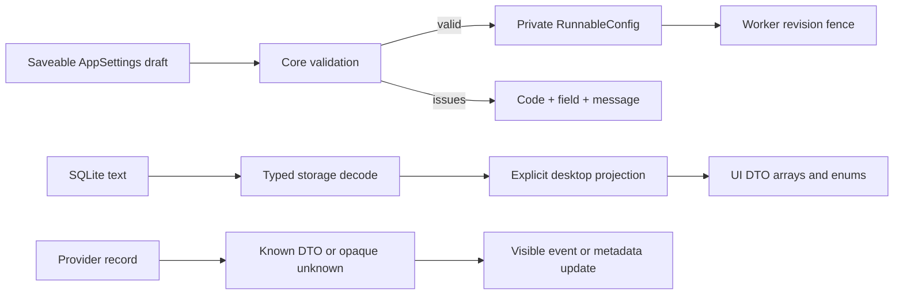

# Typed runtime and desktop boundaries

**Validate at entry; carry typed values through execution and presentation.**

| Owner | Contract |
| --- | --- |
| Core | Closed run/retro/proposal/decision/batch states, validation issues, runnable configuration, distinct provider session/thread/turn IDs. |
| Storage | Decode labels, blockers, session metadata, event JSON, and state enums once. Malformed stored values return column errors. |
| Contracts | Define UI DTOs without storage or worker dependencies. Omit raw issue snapshots and report JSON from summaries. |
| Desktop projections | Map typed records into DTOs; report decoding errors are explicit. |
| Bindings exporter | Tooling crate may depend on worker types; runtime contracts do not. |
| Frontend | Consume arrays and objects directly. Narrow opaque JSON values before reading fields. Focus validation fields by structured field identifiers, never message text. |

## Runtime invariants

- `RunnableConfig` has private fields and no deserializer. Starting or reconfiguring a worker requires its validated constructor.
- Missing repositories represent saveable incomplete setup. Every validation issue still prevents that draft becoming runnable.
- Command presence, positive numeric limits, prompt placeholders, repository namespace collisions, and session environment names/values share core validation.
- Credentials and executable availability remain runtime preflight concerns.
- Lower settings revisions cannot replace newer accepted runtime requests or start after a newer stopped-worker save. The revision fence survives stopped/stopping states; preflight generation guards protect concurrent callbacks.
- Agent session/thread/turn IDs are opaque newtypes at the storage API where adjacent string arguments were interchangeable.

## Compatibility

- Existing valid SQLite data keeps its representation; no migration is needed.
- Settings missing `settings_revision` deserialize as revision zero.
- Known malformed provider terminal/usage records fail before publishing completion; valid older records may omit optional usage fields.
- Unknown provider records remain intentionally opaque. Metadata-only updates cannot create timeline entries through a null-payload convention.

Regenerate bindings with `cargo run -p symphony-bindings --bin export-bindings -- src/bindings.ts`.
