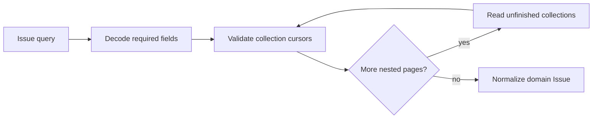

# Tracker issue completeness

**Dispatch receives complete labels and blocker relations, or a tracker error.**

| Boundary | Contract |
| --- | --- |
| Issue lists | Active, terminal, and board reads follow every top-level page. |
| Single issue | Ordinary and dispatch reads use the same collection completion path. |
| Labels and inverse relations | Initial queries request 25 entries and page metadata; follow-ups request 100 entries from each unfinished connection. |
| Request cost | Complete initial collections add no requests. Both unfinished connections advance in one request per affected issue. |
| Mandatory fields | Issue state, both connections, relation source issue/state, and pagination metadata must decode successfully. Unknown extra fields remain compatible. |
| Progress | Missing/empty/repeated cursors, empty pages claiming a cursor or successor, and more than 50 pages per collection return `TrackerError::Invalid`. An exactly complete 50th page succeeds. |
| Partial data | A failed continuation, changed issue identity, or missing requested connection fails the whole operation; no partial issue list escapes. |
| Blockers | Only inverse `blocks` relations whose source is not `completed` or `canceled` become blockers. |
| Missing issue | A missing initial single issue returns `None`; disappearance during collection pagination is an error. |

- Network DTOs validate structure before normalization; malformed responses are not retried as transport failures.
- Reads are sequential and are not a transactional snapshot of concurrent Linear edits. Invalid pagination is rejected, but valid pages can still reflect edits made between requests.
- This completion policy covers dispatch issue collections. Workpad comments and workflow-state queries keep their existing pagination logic; selected comment page metadata also requires an explicit nullable `endCursor`.

## Verification

Local HTTP fixtures exercise the production request and JSON boundary without Linear credentials:

- A dispatch-relevant label and active blocker after the first 25 entries, through every issue fetch API.
- Multiple issue pages; independent nested cursors; zero extra requests for complete nested collections.
- Missing/malformed fields, disappearing issues, cursor cycles, inconsistent page metadata, and pagination limits.

Run `cargo test -p symphony-tracker --locked --offline` with this checkout's own target directory.
