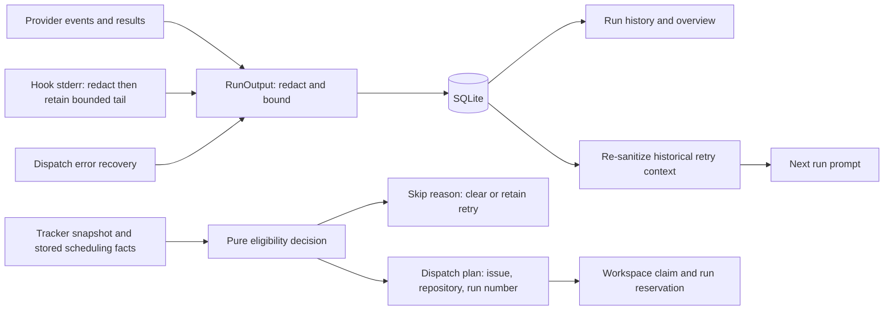

# Worker state machine

This document defines the lifecycle of the Symphony worker, issue dispatch,
run rows, retries, cancellation, and restart recovery. The implementation is
split between `symphony-worker`, `symphony-storage`, and the selected agent
adapter; changes must preserve the combined invariants described here.

## Worker lifecycle

The in-memory worker has three states:

| State | Meaning | Allowed next states |
| --- | --- | --- |
| `stopped` | The previous generation's poll loop and all owned run tasks have exited. | `running` |
| `running` | A generation owns startup, polling, configuration, and its run tasks. | `stopping` |
| `stopping` | The root token is cancelled; the supervisor is joining polling and run tasks. | `stopped` |

`start()` publishes `running` before the spawned task finishes tracker
preflight and restart recovery. This lets the UI show startup immediately.
Errors returned by startup preflight or restart recovery eventually return the
manager to `stopped` and record `last_error`. Once the
poll loop is running, an individual tick error is logged and the next
tick still runs; it does not stop the manager or update `last_error`. A failed
live-reconfiguration preflight is different again: it leaves the worker
running on the previous configuration and stores that error in `last_error`
until a later accepted reconfiguration clears it.

`stop()` is idempotent. It sets `stopping` and cancels the root token; the
worker task owns the final transition to `stopped`. Tracker requests do not
accept cancellation tokens, so startup and tick wrap each network wait and
abandon that wait when stop fires.

`start()` rejects both `running` and `stopping`. Running and stopping state
variants own their token, runtime configuration, and supervisor handle together.
Each generation owns a `JoinSet` of run supervisors; shutdown waits for dispatch,
cancellation finalization, recovery, and workspace-claim release before publishing
`stopped`. A polling panic also cancels and joins children. Cleanup is fenced by
the generation that owns it, so a prior generation cannot clear a newer one.

The worker deliberately does not race an entire tick against cancellation. A
tick may have committed a `pending` run but not yet spawned the task that owns
it. Dropping the whole future in that window would strand the row.

Live reconfiguration applies to future ticks and future dispatches. A run
keeps the configuration snapshot with which it was dispatched. Tracker
configuration changes are preflighted, and a generation counter prevents an
older save from replacing a newer configuration.

## Issue eligibility

An issue can enter normal dispatch only when all of these are true:

- it is returned by the tracker's active query;
- it has no blockers;
- it has no queued retry;
- no unchanged user-cancellation suppression applies;
- it has no `pending` or `running` run;
- it routes to a configured repository;
- no active rate limit for the selected provider blocks dispatch; and
- `pending + running` is below `max_concurrent_agents`.

Linear team and project lists determine which issues enter the active query:
each list is ORed internally, and non-empty team and project lists are ANDed
together. Repository labels and the configured default then determine routing.
An unroutable active issue is skipped rather than assigned to an arbitrary
workspace.

The worker refreshes locally known issues that leave the active query until
they reach a configured terminal state. This prevents an intermediate tracker
state from being mistaken for final completion.

## Run lifecycle

The database permits these run statuses:

- non-terminal: `pending`, `running`;
- terminal: `success`, `failure`, `timeout`, `cancelled`.

The current worker writes the following transitions:

| From | To | Trigger |
| --- | --- | --- |
| no row | `pending` | `try_reserve_run()` reserves an issue/run number and workspace path |
| `pending` | `running` | workspace setup, `after_create`, fallback skill injection, and the ready sentinel complete |
| `pending` | `cancelled` | worker or user cancellation wins at a checkpoint |
| `pending` | `failure` with class `after_create_failed` | a fresh workspace's `after_create` hook returns nonzero before promotion |
| `pending` | `failure` | setup escapes through the dispatch safety net or restart recovery finds the reservation |
| `pending` | `cancelled` with class `reconciled` | the database rejects promotion because another run for the issue is already running |
| `running` | `success` | the adapter reports success and post-run cancellation has not won |
| `running` | `failure` | a hook, adapter, persistence, dispatch, or recovery failure is recorded |
| `running` | `cancelled` | worker or user cancellation wins |

`pending` is active work, not a queue placeholder. It owns a concurrency slot
while the workspace is prepared. The database has a partial unique index for
one `running` row per issue; the worker also checks for any active run before
reserving.

Terminal rows are immutable: `complete_run()` predicates its update on
`pending` or `running` and reports whether it changed the row. Outcome, retry
creation or clearing, optional cancellation suppression, and live-session
removal commit in one transaction. The stranded-run recovery path also checks
the current status before repairing it.

Although `timeout` remains a supported persisted status for compatibility,
the native adapters currently return a timeout as `AgentError::Timeout`.
`dispatch_run` records adapter errors as a `failure` with class
`dispatch_error`; it does not currently write `RunStatus::Timeout`. Code and
documentation must not assume every turn timeout produces a `timeout` row.

## Dispatch sequence

A reserved run owns the following ordered sequence:

1. Adopt an eligible legacy workspace or create/reuse the namespaced
   `<workspace-root>/<repo>/<issue>` workspace.
2. If this is a fresh workspace, run `after_create`.
3. Ensure bundled skill fallbacks and write the ready sentinel.
4. Promote the row from `pending` to `running`. This transaction also removes
   the issue's retry row.
5. Run `before_run`.
6. Refresh fallback skills again so a setup hook cannot leave stale runtime
   copies.
7. Resolve the repository workflow and render the prompt.
8. Add a retry-context trailer from the previous run and recent normalized
   events when this is not the first attempt.
9. Launch the selected agent driver and persist normalized events.
10. Drain events sent immediately before the driver returned.
11. If the driver returned an `AgentRunResult`, run `after_run`.
12. Finish the run, update the retry state, and remove its live session.

`after_create` returning nonzero records `after_create_failed`, finishes the
run as failure, and schedules a retry. `before_run` and `after_run` exit codes
do not currently determine the run outcome by themselves. `after_run` is not
invoked when the driver returns an `AgentError` such as a spawn, protocol, I/O,
missing-result, or timeout error; that path goes directly through cancellation
arbitration and `dispatch_error` handling.

An empty workspace-root setting expands to `<app-data>/workspaces`. A leading
standalone `~` path component expands to the current user's home directory, so
values such as `~/Developer/worktrees` are absolute and do not depend on the
desktop process's working directory. Other nonempty configured roots are
retained as plain `PathBuf`s; relative roots without `~` therefore remain
relative and are interpreted against the desktop process's working directory.
Requiring all roots to be absolute (or resolving them against a documented
base) is a proposed configuration invariant, not current behavior.

Every cancellation-sensitive boundary checks the run token. This is
intentional: cancellation can arrive during clone/setup, a hook, skill
injection, workflow resolution, an adapter turn, or post-run work.

## Retry state machine

`retry_queue` contains at most one row per issue. A failure upserts the next
run number, due time, error class, and message.

Backoff is:

```text
min(1 second * 2^(run_number - 1), max_retry_backoff)
```

The exponent is bounded before calculation, and the configured cap is always
honored.

Retry behavior follows these rules:

- A queued retry suppresses normal active-issue dispatch.
- Promotion to `running` deletes the retry row transactionally.
- Success and cancellation clear the retry row.
- A retry stays queued while the issue is blocked.
- A retry is cleared when the issue is no longer active, no longer exists, or
  can no longer route to a repository.
- Provider rate limits pause normal and retry dispatch only for the selected
  backend, including provider-specific buckets such as `codex_primary`.
  Switching to an available backend does not inherit another provider's pause.
- "Retry now" moves an existing retry due time to now and wakes the worker.
- If no retry row exists but the latest run is `cancelled`, "Retry now"
  creates the next run number immediately.
- "Retry now" clears issue dispatch suppressions.

Run numbers are monotonically increasing within an issue. A retry must reuse
the number stored in `retry_queue`, not derive an unrelated number after
dispatch begins.

## Cancellation semantics

There are two cancellation sources with different redispatch intent.

### User stops one run

`stop_run()` marks the managed run with a fallback fingerprint and fires its
child token before reading run storage, then resolves the `In Review` workflow
state from the issue's own Linear team and moves the issue there. While the
Linear mutation is in flight, cancellation finalization may install a
`user_cancelled` dispatch suppression. A successful move removes that
suppression when `In Review` is inactive; if a custom configuration watches
`In Review`, Symphony retains suppression using the moved issue's normalized
fingerprint. At the next cancellation checkpoint, the worker:

1. finishes the run as `cancelled` with class `cancelled`;
2. stores the reconciled suppression fingerprint when dispatch must remain blocked;
3. clears the retry row; and
4. removes the live session.

If the Linear mutation fails, the stop command reports the tracker error but
the cancellation remains in effect and the stop path explicitly installs the
fallback suppression even if worker-wide cancellation already finalized the
run without one. This preserves the no-immediate-redispatch invariant across
both tracker failures and cancellation races.

### Worker stops

Stopping the worker fires the root token inherited by active runs. Those runs
also finish as `cancelled`, but their Linear issues remain in their current
states and no user-cancelled suppression is installed. Stopping orchestration
and declaring an individual run ready for review are different actions.

The adapter explicitly manages its child process group on Unix: timeout or
cancellation sends `TERM`, waits briefly, then sends `KILL` to the group.
Future-drop has weaker behavior. Tokio's `kill_on_drop` kills only the
immediate shell child, not the entire process group, so descendants may be
reparented and continue running. The intended invariant is that abandoning a
driver cannot leave any descendant mutating the workspace; satisfying it
requires explicit cancellation before drop or a process-group guard whose
drop path kills the group.

Hook stderr is continuously drained into a 4 KiB tail buffer; decoding and
truncation preserve valid UTF-8 even when the retained bytes begin inside a
multibyte character.

Lifecycle hooks are also launched in dedicated process groups. After every
hook result, including success, Symphony terminates descendants that outlived
the hook shell (`TERM`, then `KILL` after a short grace period). Hooks must not
use background children as services for a later lifecycle phase.

Cancellation wins over an adapter result when the worker observes the token
before committing the terminal result. This avoids recording success after
the operator has stopped the run.

## Restart and stranded-run recovery

Startup awaits tracker preflight before repairing persisted run ownership.
If tracker preflight fails or startup is cancelled during that wait,
persisted `pending` and `running` rows remain untouched. Recovery therefore
does not repair stranded local runs during a tracker outage.

After tracker preflight succeeds, every persisted `running` row is assumed to
have lost its owning process. It becomes `failure` with class
`process_crashed`, its live session is removed, and the next retry is
scheduled.

Persisted `pending` rows receive the same treatment with a message explaining
that restart happened before the run was claimed. Orphaned placeholder live
sessions for already-terminal runs are removed.

After local run recovery, the worker makes a best-effort fetch of terminal
issues; a failed cleanup fetch does not prevent active polling from starting.
An independent loop repeats the sweep hourly without blocking active-issue
refresh or dispatch. The initial terminal fetch still precedes the first poll.
Candidates without a local workspace are skipped before per-issue tracker revalidation. Immediately before cleanup,
the worker confirms that the issue is still terminal and that the tracker
configuration has not changed.

Dispatch and terminal cleanup acquire the same per-workspace claim. Dispatch
acquires it before reserving a database run and retains it through setup, agent
execution, finalization, and recovery. Cleanup acquires it before checking active
runs and awaiting tracker revalidation, then retains it through quarantine.
Contended work is skipped until a later poll/sweep. A route or root change during
revalidation must still resolve to the claimed path; otherwise cleanup skips it.
If an issue reopens after a terminal snapshot, its next run can reserve only after
the old workspace is quarantined, so cleanup cannot rename a live run's checkout.

A terminal workspace is preserved until the tracker's latest completion or
cancellation timestamp is at least one hour old. Missing timestamps, or any
present malformed timestamp, preserve the workspace rather than guessing.
Eligible workspaces are atomically renamed under the repository workspace's
`.symphony-trash` directory and entered in `workspace_cleanup_queue`; recursive
deletion is never awaited by startup or the hourly sweep. The original issue
path is therefore immediately reusable if an issue reopens after cleanup.

One app-owned collector processes cleanup jobs sequentially even when issue
orchestration is stopped. Before deleting a quarantined tree it terminates
exact processes whose current working directory is inside that tree. Failures
retry with exponential backoff capped at five minutes, interrupted `running`
jobs return to `queued` on app launch, and a missing quarantine path completes
the job. Workspace symlinks are quarantined and removed as links without
following or process-scanning their targets. Queue transitions that encounter
transient database errors are retried until durable. The Overview cleanup count
includes every row until completion.

Each dispatch also has an in-process safety net. The outer task catches:

- a returned `WorkerError` as `dispatch_error`;
- a task panic as `dispatch_panic`; and
- a task join cancellation as `dispatch_cancelled`.

It checks that the row is still non-terminal, then atomically records failure,
schedules the retry, and removes the live session through `complete_run()`.
A failed transaction leaves the run active for startup recovery.

This two-level recovery is required because errors may occur after reservation
but before normal cleanup, including while persisting an event.

## Error taxonomy

Symphony-owned error classes are intended to be stable, machine-readable
snake_case identifiers. Provider-reported classes are an exception: Codex
preserves `error.type`, Claude and Cursor preserve result `subtype`, and
OpenCode preserves `error.name` (for example `ProviderAuthError`). Consumers
must treat provider classes as opaque strings rather than assuming
snake_case.

Run output passes through `RunOutput` before persistence or UI invalidation.
Known configured credentials are redacted before byte limits are applied.

| Output | UTF-8 byte limit |
| --- | --- |
| Error message / JSON string value | 8 KiB |
| Error class / session metadata field | 256 B |
| Humanized summary / hook stderr tail | 4 KiB |
| Serialized event payload | 64 KiB |
| Retry context trailer | 32 KiB |

JSON traversal also limits depth and node count. Oversized payloads become
bounded previews; token counts remain numeric.

| Layer | Rust representation | Persisted behavior |
| --- | --- | --- |
| Tracker transport, authentication, or query | `WorkerError::Tracker` | Startup failure stops the worker and sets `last_error`; a normal tick failure is logged and polling continues without changing `last_error`. It must not be described as a database failure. |
| SQLite, serialization, or storage invariant | `WorkerError::Storage` / `StorageError` | Tick or dispatch error; a reserved run is repaired by the safety net. |
| Adapter spawn, I/O, JSON protocol, missing result, or timeout | `AgentError` | `failure`, class `dispatch_error`, retry scheduled |
| Provider-reported failure | `AgentRunResult::Failure` with provider class | `failure`, provider class preserved, retry scheduled |
| Fresh-workspace initialization | `after_create_failed` | `failure`, retry scheduled |
| Process lost across restart | `process_crashed` | `failure`, retry scheduled |
| User or worker cancellation | `cancelled` | `cancelled`, no retry |
| Concurrent-run reconciliation | `reconciled` | `cancelled`, no retry |
| Dispatch task escaped or panicked | `dispatch_error`, `dispatch_panic`, `dispatch_cancelled` | `failure`, retry scheduled |
| Provider usage limit | `rate_limited` plus a rate-limit event | `failure`, retry scheduled; active limit may pause dispatch |

Do not wrap non-storage failures in `sqlx::Error` merely to use
`WorkerError::Storage`. Workspace, hook, skill, tracker, and adapter failures
need domain-specific classes so the UI, retry context, and retros can
distinguish them. Existing compatibility mappings should be removed as
dedicated variants are introduced, not copied into new code.

## Output boundary and dispatch policy



- Secret sources: tracker API key, credential-like inherited environment keys,
  and every explicit session environment value. Matching includes literal and
  JSON-escaped values; sensitive JSON field names also redact unknown values.
- Hook capture handles credentials across read chunks before truncation.
  Explicit adapter ellipses also redact trailing credential-prefix fragments.
- Worker/configuration `Debug` implementations omit environment values and
  workflow text.
- Quota metadata has a separate canonicalization boundary: provider names and
  known Codex buckets retain their identities even when session values overlap.
  Unknown Codex bucket names become stable provider-prefixed SHA-256 identities;
  foreign provider sources are ignored. Reset times are parsed as RFC3339 and
  stored as UTC milliseconds. Invalid reset times become unknown (`None`),
  preserving the existing policy that only a known future reset pauses dispatch.
  Visible event JSON and summaries remain redacted.
- Existing database rows are not migrated. Retry prompt construction sanitizes
  historical errors and decoded event payloads again.
- This boundary does not discover unknown secrets or arbitrary encodings, and
  it does not protect files written directly by an agent. Short custom session
  values and ambiguous truncated fragments may redact ordinary words; this conservative tradeoff is intentional.
- Eligibility has no I/O. The polling loop gathers current facts and applies
  retry/state effects; only reservation acquires a workspace claim and creates
  an owned run. Capacity and provider quota pauses retain queued retries.

## Change checklist

When changing worker lifecycle code:

1. Enumerate every state transition added or removed.
2. Preserve one active run per issue and count `pending` against concurrency.
3. Check cancellation before and after each new await that can mutate durable
   state.
4. Ensure a reserved run is owned by a task before the reserving future can be
   abandoned.
5. Make terminal writes single-shot or explicitly idempotent.
6. Update retry creation, clearing, suppression, and "Retry now" together.
7. Test worker stop and individual run stop separately.
8. Test that start rejects `stopping` until owned children finish and release
   workspace claims, including when polling panics.
9. Test restart with both `pending` and `running` rows.
10. Test failures before promotion, during event persistence, and after an
   adapter result.
11. Keep tracker, storage, adapter, and domain error classes distinct.

Workspace and output regression coverage includes barrier-controlled reopening
versus quarantine, workspace aliases before/after creation, provider switching
for normal and retry dispatch, and large multibyte hook stderr.
